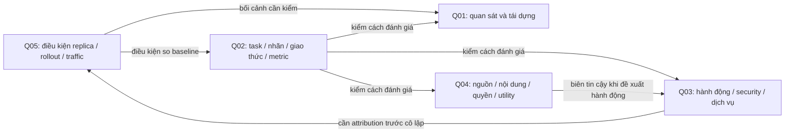

# Sau năm câu hỏi: cơ chế làm được gì?

**Cơ chế đã lặp được qua các câu hỏi khác nhau ở mức đọc/tổng hợp có ghi vết. Chưa kiểm tính ổn định của một pipeline RAG hoặc một hướng nghiên cứu có thể triển khai.** Khác biệt này quyết định bước tiếp: giữ các thành phần tri thức đã kiểm, tiếp tục thử chỗ còn thiếu, chưa trộn lại toàn kho.

## Vai trò tương hỗ

Đây là sơ đồ tổ chức công việc do AI suy luận từ các phạm vi đã đọc. Cạnh không là quan hệ nhân quả đã thí nghiệm. ID BR01–BR07 và claim giải thích cạnh nằm trong `casebook.json`; phần Q01 dùng kết quả đã có, không sửa lịch sử ca đầu.

## Những phân biệt đã được kiểm bằng ca thực

| Phân biệt | Ca làm rõ | Hệ quả cho cơ chế |
|---|---|---|
| Câu hỏi nghiên cứu và tuyên bố mới | Q01, rồi Q02–Q05 | Giữ câu hỏi học tập/tổng hợp ngay cả khi đã có nhiều lời giải từng phần |
| Nguồn có trong kho và nội dung đã được trích xuất | Q01/P11; Q05/P12 | RAG không thể thay cho đọc mục thực nghiệm/Discussion chưa được ghi vào note |
| Bản công trình và manifestation | Q02/P09; P21; Q03/P10 | Lưu đúng phiên bản và vị trí; không lấy metadata ở bản này gắn số đo ở bản khác |
| Metric gọi tên theo ứng dụng và thứ nó đo | Q03 | Mỗi claim phải có đối tượng, đơn vị đo và điều kiện suy rộng |
| Có nguồn và nguồn đáng tin cho kết luận | Q04 | Kiểm cả support, nội dung đối kháng và quyền; citation một mình không đủ |
| Tìm đúng chủ đề và tìm đúng bằng chứng | Probe tiếng Việt | Tách điều hướng Q/concept khỏi thu hồi P/K/D, rồi vẫn cần chấm sufficiency |
| Discussion đề xuất xử lý và kiểm chứng triển khai | Q05 | Ghi đề xuất như đề xuất; kiểm artifact/coverage trước kết luận hiệu quả |

## Đầu ra tri thức thực sự đã có

- Một hợp đồng đánh giá đề xuất: task, phạm vi nhãn, quan sát, split/calibration, baseline, metric, chi phí và giới hạn.
- Một bản đồ mức can thiệp: giải thích mô hình → hành động có thể thực thi → security outcome → service outcome.
- Một ma trận tin cậy trợ lý: source provenance, mức hỗ trợ kết luận, input đối kháng, tool policy, utility và oracle.
- Một mô tả điều kiện replica: version group, readiness, traffic mix, eligibility/coverage và snapshot-versus-replica attribution.

Các mục trên là **suy luận thiết kế có nguồn**, chưa là kết quả đo lường mới. Chưa tích hợp vào canonical claim vì người dùng muốn thử và tối trước.

## Lượt tối tiếp nên kiểm gì?

1. Giữ raw retrieval cho điều hướng; kiểm nhánh lấy P/K/D trên một nhóm câu khác, viết nhãn trước khi xem kết quả. Không tiếp tục chỉnh glossary cho tới khi đẹp hết bộ cũ.
2. Dùng schema nhỏ cho claim: nguồn/phiên bản/vị trí, đối tượng đo, điều kiện, điều nguồn thực sự báo cáo và giới hạn diễn giải. Lấy một vài đoạn đọc mới để thử extraction trước khi sửa toàn bộ template.
3. Lưu câu trả lời thực tế, rồi chấm support và sufficiency từng nhận định, kể cả ca phải trả lời chưa biết. Các câu trả lời A02–A05 trong lượt này là đầu ra thủ công, không là đánh giá độc lập.
4. Chọn một lát cắt thực tiễn có dữ liệu và nguồn lực thật để chạy thí nghiệm sau. Chẳng hạn Q05 có thể cung cấp môi trường cho Q02/Q03, nhưng chưa đủ dữ kiện về máy, dữ liệu hay quyền triển khai để tự chọn hoặc dự toán.

Chưa đủ căn cứ gọi toàn cơ chế ổn định: thiếu nhóm giữ lại, người đánh giá khác, pipeline generator và một ca vận hành đo được. Tuy vậy, đã có các mảnh tri thức và lỗi cơ chế cụ thể để tối tiếp, không cần loại bỏ toàn bộ nền cũ.
